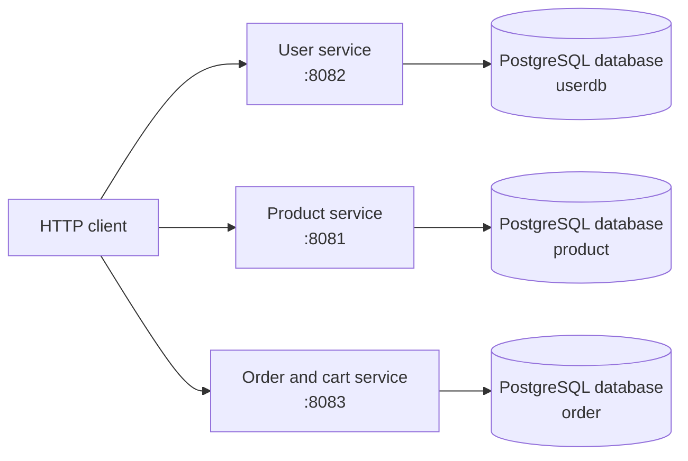

# E-commerce Microservices: Architecture and Project Summary

## Scope

This overview covers the root PostgreSQL/pgAdmin Compose setup and the `user`, `product`, and `order` Spring Boot projects. The `ecom-application` directory and `.idea` are intentionally excluded.

## Overview

The repository contains three independently buildable and runnable Spring Boot applications. Each owns its own domain model, REST API, Spring Data JPA repositories, and configured PostgreSQL database. They are separate deployable processes, not a single Maven multi-module application.

The diagram describes the configured service boundaries. All three databases currently point to one PostgreSQL server on `localhost:5432`; they are separate databases, not separate database servers or containers. There is no service-to-service call shown because none is implemented in these projects.

## Services

### User service

- Entry point: [UserApplication.java](user/user/src/main/java/com/ecommerce/user/UserApplication.java)
- Port: `8082`; database: `userdb`
- Owns users and addresses. A user has a default `CUSTOMER` role and a cascading one-to-one address relationship.
- API base path: `/api/users`
- `GET /api/users` lists users; `GET /api/users/{id}` fetches one; `POST /api/users` creates; `PUT /api/users/{id}` updates or returns 404.
- [UserService.java](user/user/src/main/java/com/ecommerce/user/services/UserService.java) maps request/response DTOs and persists through `UserRepository`.

### Product service

- Entry point: [ProductApplication.java](product/product/src/main/java/com/ecommerce/product/ProductApplication.java)
- Port: `8081`; database: `product`
- Owns product name, description, price, stock, category, image URL, and active state.
- API base path: `/api/products`
- `POST /api/products` creates; `GET /api/products` lists active products; `PUT /api/products/{id}` updates; `DELETE /api/products/{id}` soft-deletes by setting `active=false`; `GET /api/products/search?keyword=...` searches active products with stock greater than zero by name.
- [ProductRepository.java](product/product/src/main/java/com/ecommerce/product/repository/ProductRepository.java) implements the active-product and search queries.

### Order service

- Entry point: [OrderApplication.java](order/order/src/main/java/com/ecommerce/order/OrderApplication.java)
- Port: `8083`; database: `order`
- Owns carts, orders, and order items. Cart/order records store user and product identifiers as strings; there are no cross-database foreign keys.
- Cart API base path: `/api/cart`; requests require the `X-User-Id` header. `POST /api/cart` adds an item, `GET /api/cart` lists the user's items, and `DELETE /api/cart/items/{productId}` removes one.
- Order API base path: `/api/orders`; `POST /api/orders` creates an order from the current cart and expects the `X-User-ID` header (HTTP header names are case-insensitive).
- [OrderService.java](order/order/src/main/java/com/ecommerce/order/services/OrderService.java) persists an order as `CONFIRMED`, then clears the cart. An empty cart results in 400.

## Technology and Data

Each service has its own `pom.xml`, Spring Boot main class, `application.yml`, entities, repositories, and tests. The projects use Java 25, Spring Boot 4.1.1, Spring MVC, Spring Data JPA/Hibernate, PostgreSQL, and Lombok. Hibernate is configured with `ddl-auto: update`, and SQL logging is enabled.

The database URLs are configured directly in each service's `application.yml`:

| Service | JDBC database | Port |
| --- | --- | ---: |
| User | `userdb` | 8082 |
| Product | `product` | 8081 |
| Order | `order` | 8083 |

All use the local PostgreSQL credentials `embarkx` / `embarkx`. The root [docker-compose.yml](docker-compose.yml) starts PostgreSQL 14 and pgAdmin, exposing PostgreSQL on `5432` and pgAdmin on `5050`. It does not start the Java services. Since the Compose file does not set `POSTGRES_DB` or provision the three configured database names, create `userdb`, `product`, and `order` in PostgreSQL before starting the services. Its credentials are development defaults, not production secrets.

## Running Locally

1. Start PostgreSQL: `docker compose up -d postgres` from the workspace root.
2. Create the three databases in the PostgreSQL instance if they do not already exist.
3. In separate terminals, run the Maven wrapper with `spring-boot:run` from each service directory: `user/user`, `product/product`, and `order/order`.
4. Send requests to ports `8082`, `8081`, and `8083` respectively.

Each service can also be built/tested independently with its own Maven wrapper, for example by running `mvnw.cmd test` from `product/product` on Windows.

## Request and Data Flow

As implemented, a client can create a user, browse products, and add a product identifier to a cart by calling the respective services. The order service does not look up the user or product, check product stock, or obtain the product's actual price. It accepts the supplied identifiers and handles its own local cart/order records. Thus the current order flow is not a complete cross-service checkout flow.

## Notable Gaps and Risks

- **Cart prices are placeholders.** [CartService.java](order/order/src/main/java/com/ecommerce/order/services/CartService.java) hard-codes each item's price to `1000.00`; it does not call the product service or validate the item/user.
- **Cart and order totals can disagree.** Order total is the sum of item `price` values, while each response item's subtotal is `price * quantity`. The hard-coded price is also retained when cart quantity is incremented.
- **No identity validation.** User IDs and product IDs are accepted as header/body strings without checking either owning service. There is no authentication/authorization layer in these service projects.
- **Checkout is not coordinated.** Saving an order and clearing the cart are sequential local persistence operations, not a distributed transaction or an idempotent workflow. Retries/failures need deliberate handling before production use.
- **Database setup is incomplete for a fresh Compose volume.** The three configured databases must be provisioned; Compose only defines the PostgreSQL server and pgAdmin.
- **Input constraints and error handling are thin.** The REST endpoints largely accept DTOs without bean validation; user creation returns 200 rather than the conventional 201, and no email uniqueness rule is defined in the visible model.
- **Tests are smoke tests.** Each service has a single Spring context-load test; there are no endpoint, repository, or checkout behavior tests in the inspected test sources.
- **No operational layer is present here.** The three projects do not define an API gateway, service discovery, centralized configuration, message broker, or service orchestration. The root Compose file only covers local database tooling.

## Architectural Takeaway

The code has the beginnings of a database-per-service architecture: each domain has an independent deployable Spring Boot application and targets a distinct PostgreSQL database. The services can be started separately, but the current implementation has no runtime integration between them. In particular, order/cart behavior uses placeholder pricing and identifier strings rather than validating against user/product ownership. Treat it as a learning/prototype baseline rather than a production-ready checkout system.